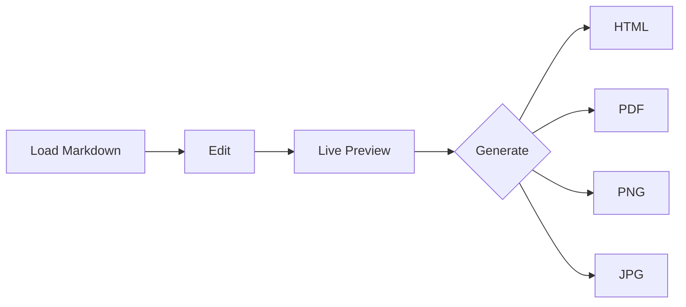

# Markdown Mermaid Demo

This document exercises normal Markdown and a Mermaid diagram.

## Checklist

- Edit text on the left.
- Confirm live preview on the right.
- Generate HTML/PDF/PNG/JPG from the current editor content.

## Mermaid

## Table

| Format | Source |
| --- | --- |
| HTML | Direct export |
| PDF | Headless browser |
| PNG | Headless browser screenshot |
| JPG | PNG conversion |
